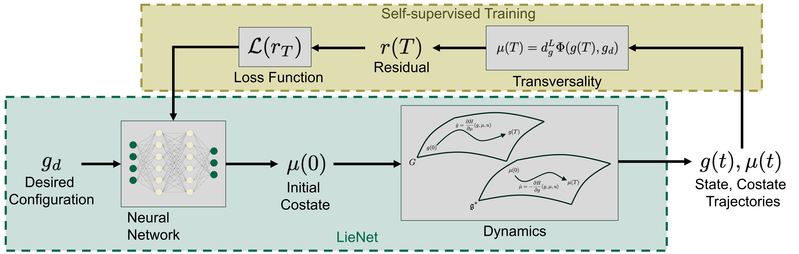

# LieNet

**Fast Optimal Control Through Geometry and Learning**

LieNet is an ongoing research project investigating how **geometric optimal control** and **self-supervised learning** can be combined to accelerate motion planning on matrix Lie groups.

Classical optimal-control solvers repeatedly integrate differential equations and update candidate solutions for every new target. LieNet instead learns to predict an **initial costate** from a desired configuration. The predicted costate is integrated through known Pontryagin Maximum Principle (PMP) equations to produce a control signal and its state trajectory.

> **Publication status:** This work is **unpublished** and under active development. The source code and implementation details will be released in this repository **after publication**.

## Research approach

The key observation is that the initial costate parameterizes a solution of the PMP initial-value equations. If it can be predicted accurately, the state, costate, and control trajectories can be generated by forward integration rather than an iterative boundary-value solver.

LieNet does **not** learn the robot dynamics from data. Instead, it embeds those known dynamics and optimality conditions into the training procedure. It also does not require labeled trajectories generated by a numerical optimizer.

*LieNet predicts an initial costate from the desired configuration and integrates the known PMP dynamics; the terminal transversality residual supplies the self-supervised training signal.*

## Publication and code availability

**This research has not yet been published.** The project is under active development, and the code will be made publicly available here **following publication**.

## Research team

- **[Xincheng Li](https://xincheng.li)** — University of South Florida
- **[Udit Halder](https://sites.google.com/view/udithalder/)** — University of South Florida
- **[Biswadip Dey](https://d-biswa.github.io/)** — Meta

## Correspondence

**Prof. Udit Halder**  
Department of Mechanical and Aerospace Engineering, University of South Florida  
Email: [udithalder@usf.edu](mailto:udithalder@usf.edu)  
Website: [Udit Halder](https://sites.google.com/view/udithalder/)
